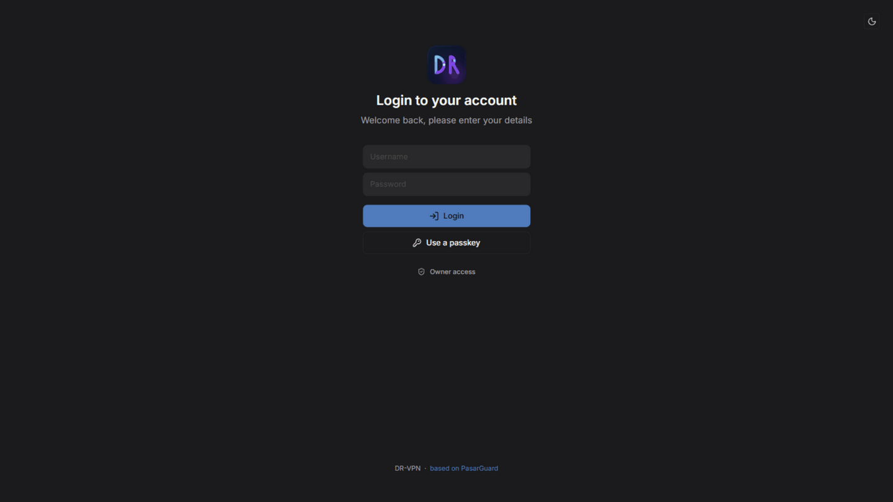
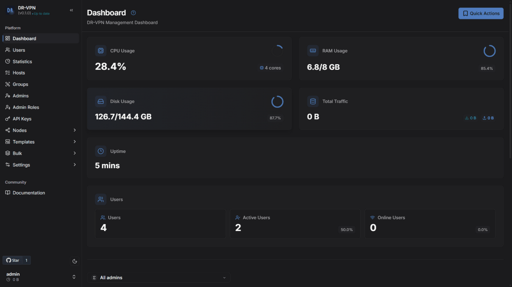
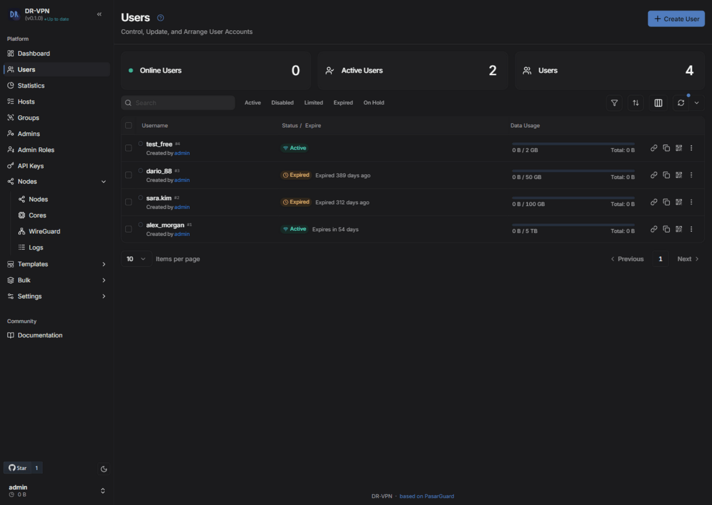
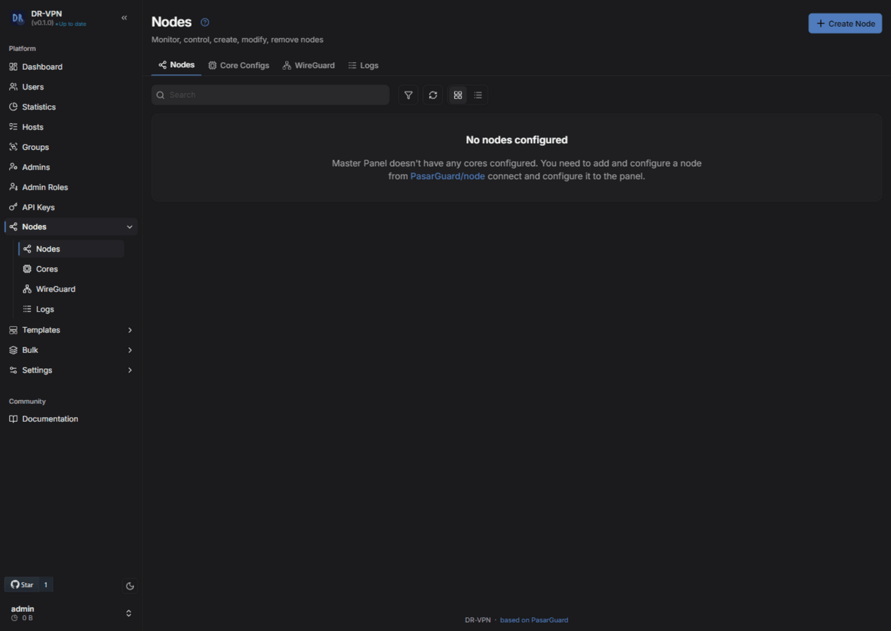

<p align="center">
  <a href="#" target="_blank" rel="noopener noreferrer">
    
  </a>
</p>

<h1 align="center">⚡ DR-VPN</h1>

<p align="center">
    <strong>Lightweight Proxy Management Panel</strong>
</p>

<p align="center">
  <a href="./README-fa.md">🇮🇷 فارسی</a>
</p>

---

> [!WARNING]
> **DR-VPN is an early release (v0.1.1) under active development.** The panel,
> the one-command installer and the dashboard are functional (the full test
> suite passes; the installer was tested end-to-end on a fresh Ubuntu 24.04
> box). Still on the roadmap: resource benchmarks, the reseller ("sponsorship")
> module and the full dashboard redesign. See the [Roadmap](#️-roadmap).

## 📖 What is DR-VPN?

DR-VPN is a lightweight, self-hosted proxy management panel for running and
administering hundreds of proxy accounts through a clean web dashboard, a full
REST API and a CLI. It manages [Xray-core](https://github.com/XTLS/Xray-core)
configurations and works with remote Xray nodes.

DR-VPN is a fork of
[PasarGuard](https://github.com/PasarGuard/panel) (AGPL-3.0), which is itself
derived from [Marzban](https://github.com/Gozargah/Marzban). DR-VPN's goals are
a fully independent visual identity, a reseller ("sponsorship") system, a
clean English-only dashboard, and reduced resource usage on small VPS
servers. All credit for the underlying codebase belongs to the upstream
projects — see [NOTICE.md](NOTICE.md).

## 🖼️ Screenshots

| | |
|---|---|
|  |  |
|  |  |

## ✨ Features

**🌐 Web Interface & API**
- Built-in **Web UI** dashboard (React) with dark/light themes, English-only
- Fully **REST API** backend (OpenAPI schema included)
- **Multi-Node** support for infrastructure distribution

**🔐 Protocols & Security**
- Supports **Vmess**, **VLESS**, **Trojan**, **Shadowsocks**, **WireGuard** and **Hysteria2**
- **TLS** and **REALITY** support
- **Multi-protocol** for a single user

**👥 User Management**
- **Multi-user** on a single inbound, **multi-inbound** on a single port (fallbacks)
- **Traffic** and **expiry** limits, periodic limits (daily, weekly, …)
- **HWID/device** limits
- **Multi-admin** with **RBAC** (scoped permissions, per-admin user ownership)

**🔗 Subscriptions & Sharing**
- Subscription links compatible with **V2ray**, **Clash**, **ClashMeta**, **sing-box** and more
- Automatic **share link** and **QR code** generation
- Traffic statistics and monitoring

**🛠️ Tools & Customization**
- Customizable Xray configuration with validation
- Integrated **Telegram Bot** (optional)
- **CLI** for setup keys and administration
- **Multi-language** UI (English / فارسی / Русский / 中文) with full RTL support

## 🚀 Installation

### One command (recommended)

```bash
sudo bash -c "$(curl -fsSL https://raw.githubusercontent.com/behymin12345-hash/DR-VPN/main/scripts/drvpn.sh)" @ install
```

The installer asks you interactively (panel port, database, SSL/domain —
PasarGuard-style wizard) and then detects Ubuntu 20.04/22.04/24.04, installs
uv + Python 3.14, deploys the prebuilt dashboard, runs migrations, creates
the `drvpn` systemd service (auto-start on boot), prints a one-time setup
key for the owner account and exposes a `drvpn` management CLI:

```bash
drvpn status          # service status + health check
drvpn ssl             # add/replace/remove the SSL domain later
drvpn cli generate-temp-key
drvpn backup          # database + config archive
drvpn update          # backup -> git pull -> migrate -> restart
drvpn help            # all commands
```

Install options (they pre-answer the wizard): `--port 8000`,
`--ssl-domain example.com` (needs port 80), `--no-ssl`, `--database sqlite|postgresql|mysql`,
`--db-url URL`, `--version X.Y.Z`, `--yes` (fully silent for automation).
Without SSL the panel binds to localhost only (security default) — add a
domain with `drvpn ssl` or use an SSH tunnel for first access.

<details>
<summary>Manual installation (development)</summary>

Requirements: Linux x86_64 or Windows, plus [uv](https://docs.astral.sh/uv/).

```bash
# 1. Get the code
git clone https://github.com/behymin12345-hash/DR-VPN.git
cd DR-VPN

# 2. Install Python 3.14 + dependencies (uv manages everything)
uv sync

# 3. Configure
cp .env.example .env   # then edit UVICORN_UVicorn settings as needed

# 4. Run the panel
uv run python main.py

# 5. In another terminal, create a one-time setup key for the owner account
uv run python drvpn-cli.py generate-temp-key
```

Then open the dashboard and use the setup key to create the owner account.
Without SSL certificates the panel binds to localhost only — use an SSL
certificate or SSH port forwarding for first access:

```bash
ssh -L 8000:localhost:8000 user@serverip
# then open http://localhost:8000/dashboard/
```

See [INSTALL.md](INSTALL.md) for details, environment variables and systemd notes.

</details>

### Nodes

The panel does not run Xray itself — **at least one node** is required
(same server or separate). Install it right after the panel:

```bash
sudo drvpn install-node     # installs the node runtime (asks API key/port)
sudo drvpn edit-env-dr      # node settings: SERVICE_PORT / API_KEY / protocol
```

Then in the dashboard: **Nodes → Create Node** (address, port `62050`,
API key from the node, certificate from `/var/lib/pg-node/certs/ssl_cert.pem`).
Full guide with a single-server quick start: [docs/NODE-SETUP.md](docs/NODE-SETUP.md).

### Docker

```bash
# pull the published image (built automatically by CI)
docker pull ghcr.io/behymin12345-hash/dr-vpn:v0.1.0

# or build it yourself from source
docker build -t dr-vpn .

docker run -d --name dr-vpn --network host -v /var/lib/drvpn:/var/lib/drvpn --env-file .env dr-vpn
```

## 📚 Documentation

- Full documentation (upstream, matches current functionality): [docs.pasarguard.org](https://docs.pasarguard.org)
- Architecture analysis of this fork: [docs/ARCHITECTURE-REPORT.md](docs/ARCHITECTURE-REPORT.md)

## 🗺️ Roadmap

| Stage | Scope | Status |
|---|---|---|
| 1 | Repository architecture analysis | ✅ Done |
| 2 | DR-VPN branding & identity | ✅ Done |
| 3 | Runnable baseline: syntax fixes, green test suite, first release | ✅ Done |
| 4 | One-command installer (systemd, backup/restore/update) | ✅ Done |
| 5 | Performance pass, resource profiles, benchmarks | 🔨 In progress |
| 6 | Sponsorship / **reseller** module | ⏳ Planned |
| 7 | Full dashboard redesign | ⏳ Planned |
| 8 | Security & QA pass | ⏳ Planned |
| 8 | Security & QA pass | ⏳ Planned |
| 9 | Mature public release | ⏳ Planned |

## 📄 License & Attribution

DR-VPN is licensed under the **[GNU AGPL-3.0](LICENSE)**, inherited from
PasarGuard. The upstream projects retain full credit for the original codebase:

- [PasarGuard](https://github.com/PasarGuard/panel) — AGPL-3.0, © PasarGuard organization
- [Marzban](https://github.com/Gozargah/Marzban) — the original Marzban project

If you run a modified version of this software as a network service, AGPL-3.0
§13 requires you to offer its Corresponding Source to your service's users.
See [NOTICE.md](NOTICE.md) for details.

---

<p align="center">
  DR-VPN · an independent identity for a proven codebase
</p>
